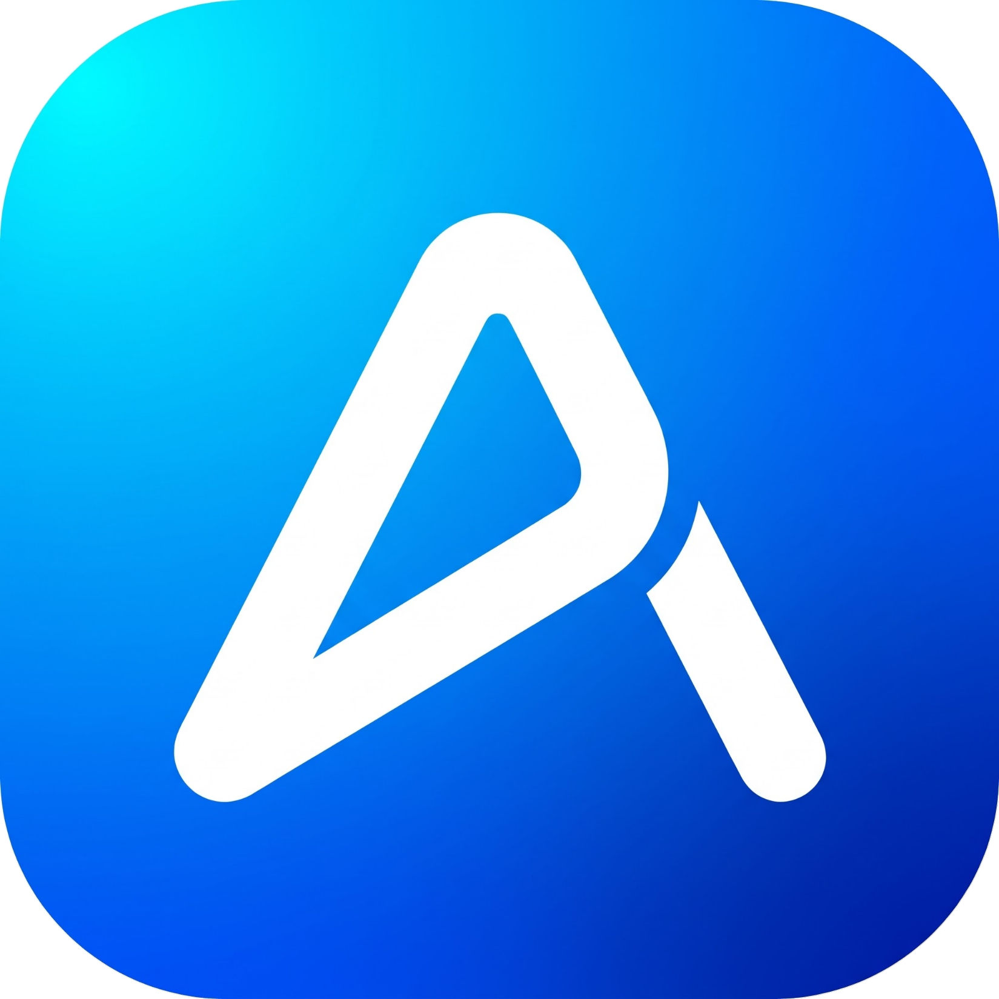
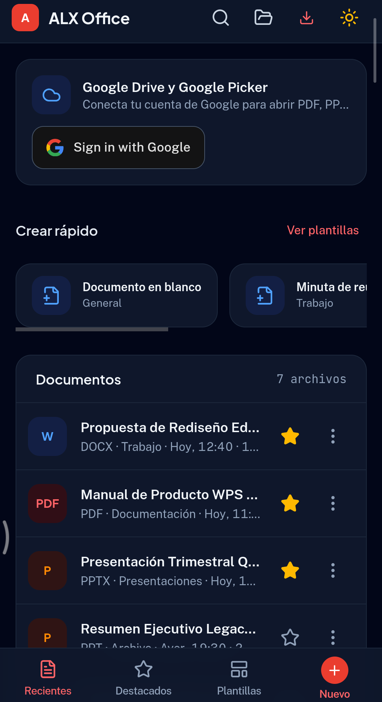
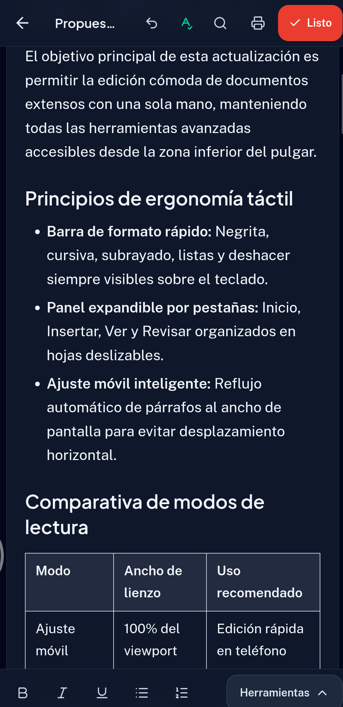

<p align="center">
  
</p>

# ALX Office

Suite de oficina móvil y web progresiva (**PWA**) diseñada para editar y visualizar documentos **DOCX/DOC/TXT**, archivos **PDF** y presentaciones **PPT/PPTX** directamente en el navegador o instalada en Android/iOS con soporte sin conexión.

## Características principales

- **Editor de documentos (DOCX / DOC / TXT)** con barra ergonómica inferior (`Inicio`, `Insertar`, `Ver`, `Revisar`), tablas editables, listas, casillas de verificación, vista de impresión y corrector ortográfico en español con menú contextual.
- **Visor y editor de PDF en la misma vista** con barra de miniaturas lateral, edición directa de texto, anotaciones (firma, resaltado, recuadros, tapar texto), organización de páginas y descarga en `.pdf`.
- **Visor y editor de presentaciones (PPT / PPTX)** con edición enriquecida dentro de cada diapositiva, notas del orador, cuadrícula visual y modo presentación a pantalla completa.
- **Almacenamiento local y Google Drive** con guardado automático offline (PWA + caché local) e integración con **Google Picker**.

## Capturas de pantalla

| Inicio y gestor de archivos | Editor de documentos | Visor de presentaciones PPTX |
| :---: | :---: | :---: |
|  |  |  |

## Enlaces directos de los recursos en GitHub

Al subir este repositorio a GitHub, el icono y las tres capturas quedan alojados en las siguientes rutas relativas (y disponibles como URL directa reemplazando `<USUARIO>` y `<REPOSITORIO>`):

- **Icono de la aplicación:** `public/assets/aistudio/1794708396591_f43e1352.png`
  - URL raw: `https://raw.githubusercontent.com/<USUARIO>/<REPOSITORIO>/main/public/assets/aistudio/1794708396591_f43e1352.png`
- **Inicio:** `public/assets/aistudio/Screenshot_2026-11-14-21-51-43-529_com.android.chrome_70780b2d.png`
  - URL raw: `https://raw.githubusercontent.com/<USUARIO>/<REPOSITORIO>/main/public/assets/aistudio/Screenshot_2026-11-14-21-51-43-529_com.android.chrome_70780b2d.png`
- **Editor de documentos:** `public/assets/aistudio/Screenshot_2026-11-14-21-52-43-329_com.android.chrome_3c5e6256.png`
  - URL raw: `https://raw.githubusercontent.com/<USUARIO>/<REPOSITORIO>/main/public/assets/aistudio/Screenshot_2026-11-14-21-52-43-329_com.android.chrome_3c5e6256.png`
- **Visor PPTX:** `public/assets/aistudio/Screenshot_2026-11-14-21-52-24-276_com.android.chrome_2b1aa0c5.png`
  - URL raw: `https://raw.githubusercontent.com/<USUARIO>/<REPOSITORIO>/main/public/assets/aistudio/Screenshot_2026-11-14-21-52-24-276_com.android.chrome_2b1aa0c5.png`

## Desarrollo y compilación

```bash
npm install
npm run dev      # Servidor de desarrollo en http://localhost:3000
npm run lint     # Verificación de tipos TypeScript (tsc --noEmit)
npm run build    # Compilación de producción y PWA en dist/
```
