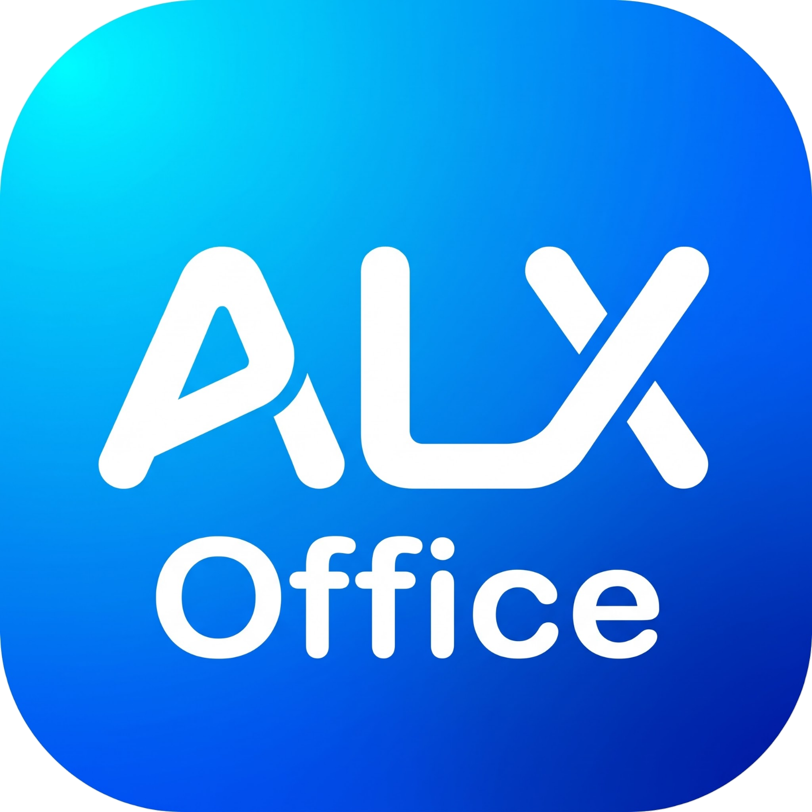
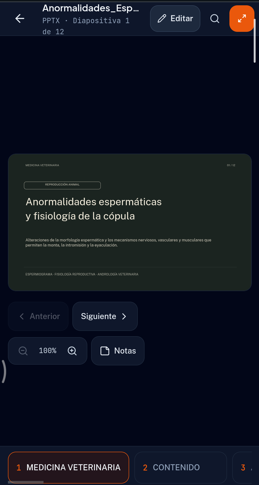

<p align="center">
  
</p>

# ALX Office

Suite de oficina móvil y aplicación web progresiva (**PWA**) para crear, visualizar y editar documentos **Word (`DOCX`/`DOC`/`TXT`)**, archivos **PDF** y presentaciones **PowerPoint (`PPT`/`PPTX`)** directamente en su propia vista, con la **misma barra de edición de Word** en todos los formatos, soporte sin conexión y compilación de **APK Android** (`com.alx.office`).

## Características principales

- **Barra de edición unificada estilo Word en todos los formatos** (`DOCX`/`DOC`/`TXT`, `PDF` y `PPT`/`PPTX`): barra inferior rápida (`Negrita`, `Cursiva`, `Subrayado`, listas, casillas) y panel **Herramientas** (`Inicio`, `Insertar`, `Ver`, `Revisar`) con estilos, colores, resaltado, tablas, imágenes, enlaces, comentarios y corrector ortográfico en español con menú contextual.
- **Editor de documentos (DOCX / DOC / TXT)** con ajuste móvil, página A4 o **modo Vista de impresión** (selector A4/Carta, márgenes normales/estrechos/amplios y papel blanco o color de fondo), buscar y reemplazar, contador en vivo y exportación en `.doc`, `.html` y `.txt`.
- **Visor y editor de PDF en su propia vista** con panel lateral de miniaturas, edición directa de texto con herramientas Word, anotaciones (firma, resaltado, recuadros, tapar texto), **modo Vista de impresión PDF** (todas las páginas listas para impresión sin filtros de lectura), organización de páginas y descarga en `.pdf`.
- **Visor y editor de presentaciones (PPT / PPTX)** con edición enriquecida dentro de cada diapositiva, notas del orador, cuadrícula visual y modo presentación a pantalla completa.
- **Almacenamiento local offline y Google Drive** con guardado automático en caché e integración con **Google Picker**.

## Capturas de pantalla

| Inicio y gestor de archivos | Editor de documentos | Visor de presentaciones PPTX |
| :---: | :---: | :---: |
|  |  |  |

## Enlaces directos de los recursos en GitHub

Al subir el repositorio de **`alex2323-droid`** en GitHub (reemplazando `ALX-Office` por el nombre de tu repositorio), el icono y las tres capturas quedan disponibles en:

- **Icono de la aplicación:** `public/assets/aistudio/1794773231252_a0df14cb.png`
  - URL raw: `https://raw.githubusercontent.com/alex2323-droid/ALX-Office/main/public/assets/aistudio/1794773231252_a0df14cb.png`
- **Inicio:** `public/assets/aistudio/Screenshot_2026-11-14-21-51-43-529_com.android.chrome_70780b2d.png`
  - URL raw: `https://raw.githubusercontent.com/alex2323-droid/ALX-Office/main/public/assets/aistudio/Screenshot_2026-11-14-21-51-43-529_com.android.chrome_70780b2d.png`
- **Editor de documentos:** `public/assets/aistudio/Screenshot_2026-11-14-21-52-43-329_com.android.chrome_3c5e6256.png`
  - URL raw: `https://raw.githubusercontent.com/alex2323-droid/ALX-Office/main/public/assets/aistudio/Screenshot_2026-11-14-21-52-43-329_com.android.chrome_3c5e6256.png`
- **Visor PPTX:** `public/assets/aistudio/Screenshot_2026-11-14-21-52-24-276_com.android.chrome_2b1aa0c5.png`
  - URL raw: `https://raw.githubusercontent.com/alex2323-droid/ALX-Office/main/public/assets/aistudio/Screenshot_2026-11-14-21-52-24-276_com.android.chrome_2b1aa0c5.png`

## Paquete y Releases en GitHub

- **Nombre del paquete (`package.json`):** `alx-office` (`v5.1.0`)
- **ID del paquete Android (`applicationId` en `capacitor.config.json`):** `com.alx.office`
- **Archivo APK de Release generado:** `ALX-Office-v5.1.0.apk`
- **Equipo de IA gratuito integrado:** Gemini 4 Hydrogen, **Gemma 4** (`gemma-4-e4b-it`, `gemma-4-e2b-it`, `gemma-4-26b-a4b-it`, `gemma-4-31b-it`), NVIDIA NIM (`Kimi K3.1 Pro`), OpenRouter `:free` (`Nemotron 550B Ultra`, `Nemotron Lightning`, `Nemotron Super VL`, `ERNIE 5.5 Flash`) y Groq (`GPT-120B`, `Qwen-27B`, `GPT-20B`, `Whisper V3 Turbo`).
- **Página de Releases:** `https://github.com/alex2323-droid/ALX-Office/releases/latest`
- **Enlace directo de descarga del APK:**  
  `https://github.com/alex2323-droid/ALX-Office/releases/download/v5.1.0/ALX-Office-v5.1.0.apk`

El flujo para generar la APK está disponible en [`ci/release-apk.yml`](ci/release-apk.yml). Una vez que subas el repositorio a GitHub, puedes activarlo moviendo este archivo a `.github/workflows/release-apk.yml` para compilar automáticamente el APK firmado (`v5.1.0`) y publicarlo en **Releases**.

## Desarrollo y compilación

```bash
npm install
npm run dev      # Servidor de desarrollo en http://localhost:3000
npm run lint     # Verificación de tipos TypeScript (tsc --noEmit)
npm run build    # Compilación de producción y PWA en dist/
```
